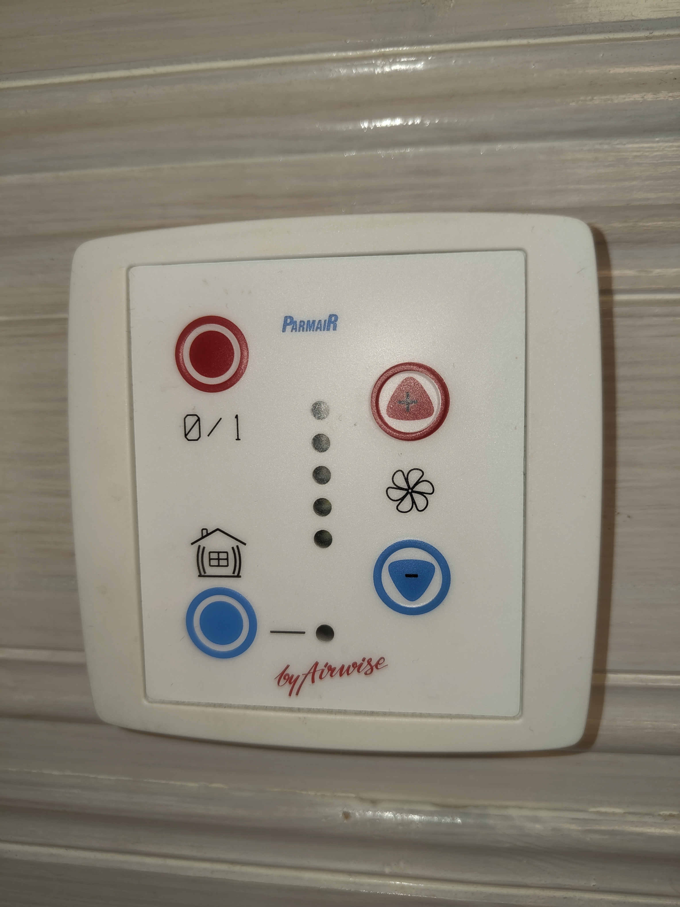

# Parmair – ESPHome and Home Assistant

Bring the four buttons of an older Parmair by Airwise wall controller into
Home Assistant using a **Seeed Studio XIAO ESP32-C3**. The original keypad
remains usable. A separate Shelly power meter provides a fan-level estimate,
displayed as five segments with slower/faster controls on the dashboard.



See the [installation photos and limitations](photos/README.md) for the current build.

> **Unit model:** the repository name historically refers to EXVK. A previously
> inspected nameplate photo was interpreted as **Parmair iiwari ExSeK**; that
> photo is no longer included. Check your own unit and controller: a shared
> manufacturer name does not guarantee identical wiring.

## Start here

1. [Installation from scratch](docs/getting-started.md) – hardware, measurements,
   ESPHome, initial installation, and testing.
2. [Wiring and safety](docs/wiring.md) and the [wiring diagram](docs/direct-gpio-wiring.svg).
3. [Power measurement and fan-level estimation](docs/power-sensor.md) – Shelly,
   a 20-second mean, calibration, and a complete Home Assistant package.
4. [Building the dashboard](docs/dashboard.md) – JavaScript resource,
   entity mapping, and a complete example view.
5. [Recorded measurements](docs/measurements.md) and [photos](photos/README.md).

## How it works

```text
Home Assistant → ESPHome button → 200 ms GPIO pull-down → wall controller
Shelly power meter → 20 s mean → estimated fan level 1–5 → dashboard
```

| XIAO | Parmair keypad pin | Function |
|---|---:|---|
| D1 / GPIO3 | 1 | Minus |
| D2 / GPIO4 | 2 | Plus |
| D3 / GPIO5 | 3 | House button |
| D4 / GPIO6 | 4 | Power 0/1 |
| GND | 5 / verified GND | Common ground |

GPIOs use **open-drain**, active-LOW operation. OFF releases the pin;
the ESP32 does not drive the keypad signal HIGH. `Button control enabled`
always starts OFF. The configuration also includes NTP, Wi-Fi diagnostics,
and an ESP32 restart button.

## Important limitations

- **Direct GPIO wiring is not galvanically isolated.** A 3 V reading alone
  is insufficient: verify common ground, polarity, electrical signal behavior,
  and the controller circuit's safe isolation from mains power.
- **The Parmair may back-power an unpowered ESP32 through its GPIOs.** YAML
  cannot provide power-off protection. Do not leave signal wires connected
  with the Parmair powered and the ESP32 unpowered unless suitable protection
  has been implemented. Use an external driver or isolated switch if needed.
- The installed build uses **Parmair 12 V → 5 V buck converter → XIAO 5V and GND pins**,
  connected directly, not through USB-C. Use a separate safe USB supply for initial programming
  and disconnected bench tests. Verify the tap points, source capacity, and
  converter output before connecting; never apply 12 V directly to the XIAO.
- The fan level is **estimated from electrical power**, not read from the unit.
  Post-heating can prevent or distort detection. Unknown does not mean OFF.
- The house button reproduces the original button. Do not label it as
  home/away without checking the unit's manual.

## Repository contents

| Path | Contents |
|---|---|
| `esphome/parmair-controller.yaml` | XIAO firmware configuration |
| `esphome/secrets.example.yaml` | Credential placeholders, not real secrets |
| `home-assistant/parmair-power.yaml` | HA package: mean power and estimated level |
| `home-assistant/parmair-speed-card.js` | Dependency-free Lovelace card |
| `home-assistant/parmair-speed-card.yaml` | Single-card configuration |
| `home-assistant/dashboard-view.yaml` | Complete ventilation view template |
| `home-assistant/parmair-speed-card.test.cjs` | Mock tests for the card |
| `docs/` | Installation, measurements, and usage guides |
| `photos/` | Original controller and installation photos |

**Do not mix the YAML files:** `esphome/` belongs in ESPHome Device Builder.
`home-assistant/` belongs in Home Assistant or a Lovelace dashboard.
MCP is an optional management method; installation does not require it.

Documentation, comments, and UI labels are in English. Existing entity IDs,
unique IDs, and the `kodinhoitohuone` view path are retained for compatibility;
some therefore contain Finnish words. Check entity IDs when installing from scratch.

## Local checks

```sh
node --test home-assistant/parmair-speed-card.test.cjs
esphome config esphome/parmair-controller.yaml
git diff --check
```

The ESPHome check requires a local `esphome/secrets.yaml` first.
Validate the Home Assistant package using HA's own configuration check.

## Before publishing changes

Keep real credentials in ignored local files. Do not publish logs, Home
Assistant state/backups, private server URLs, or screenshots exposing network
identifiers. Strip photo metadata (including GPS and embedded thumbnails)
and inspect visible labels before adding new images. The included secret
values are placeholders; example entity IDs are not credentials.
