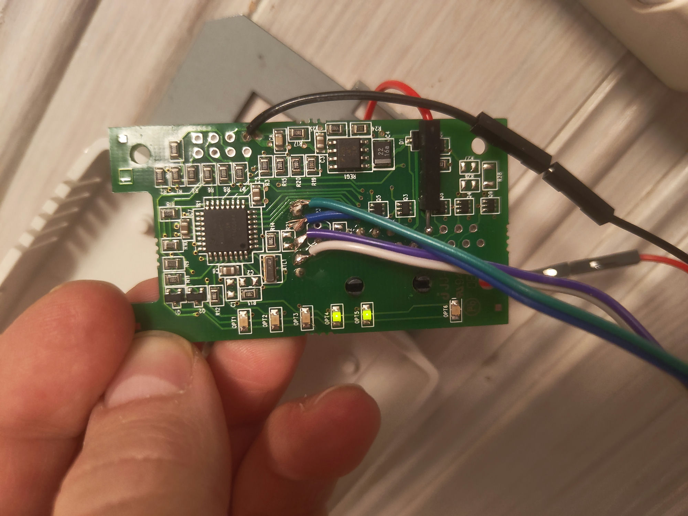
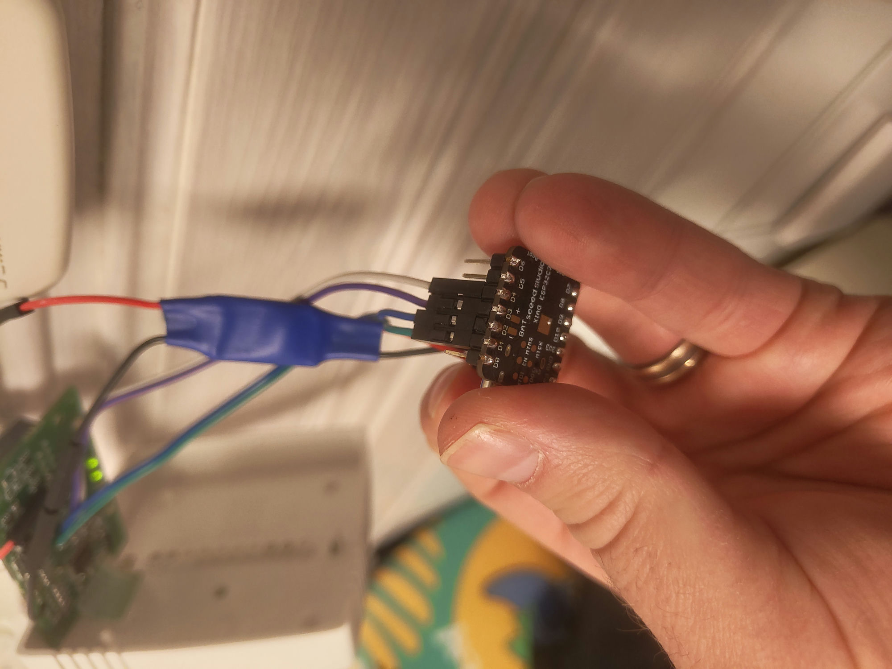
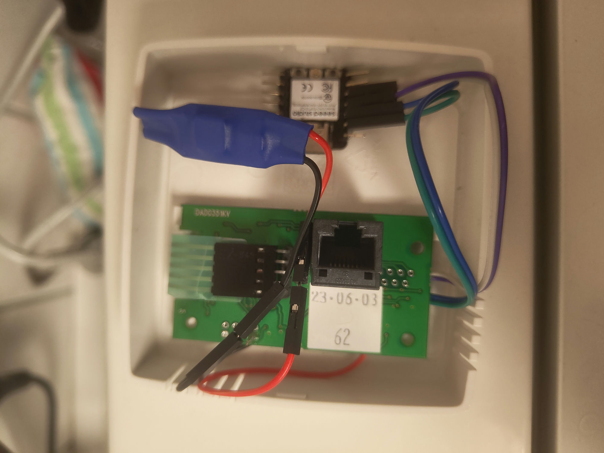

# Parmair: direct open-drain button control

## Owner confirmation, 2026-11-21

The owner confirmed that the buttons connect to the PCB ground point.
The design interprets pin 5 as common ground, with each signal pin 1–4
connecting to it **only while its button is pressed**. A released signal
must be approximately +3 V relative to this same ground. If all signals
are permanently grounded, this interpretation does not apply: do not connect.
This supersedes an earlier uncertain continuity report; it is an owner
confirmation, not a measurement performed by the assistant.

Common ground alone does not establish electrical compatibility. Before
connecting, check polarity, GPIO voltage limits, and pull-down current for
each signal. Check possible scanning with an oscilloscope if necessary.
A GPIO must not pull against an actively driven HIGH output.

## Wiring diagram

This is a functional diagram, not the board's physical pin layout.
See [direct-gpio-wiring.svg](direct-gpio-wiring.svg).

Both sides of the original PCB are shown in the [photo directory](../photos/README.md).
Identify solder points by measurement on your own board; wire color and viewing
direction in a photo do not replace verification.

```text
Parmair nominal 12 V ── Buck IN+    OUT+ (5 V) ── XIAO 5V pin
Parmair supply GND ──── Buck IN−    OUT− (GND) ── XIAO GND pin

D1 / GPIO3 ───────────────────────── Parmair 1 (minus)
D2 / GPIO4 ───────────────────────── Parmair 2 (plus)
D3 / GPIO5 ───────────────────────── Parmair 3 (house)
D4 / GPIO6 ───────────────────────── Parmair 4 (power 0/1)
GND ──────────────────────────────── Verified Parmair GND / pin 5
```

## Power supply

The owner confirms that the installed build uses a **12 V to 5 V step-down
(buck) converter**, rather than permanent USB power. Connect the converter's
regulated output directly to the XIAO **5V pin**, and its negative output
directly to the **GND pin**. Installed power does not pass through USB-C.
Do not use 3V3 or a GPIO for the 5 V supply. For the
non-isolated arrangement shown, the supply return and keypad ground must
be verified as the same common ground; do not assume this from wire colors.

- Identify and measure the nominal 12 V source and its polarity on your unit.
  The earlier reading was approximately 11.82 V. Exact PCB tap points and
  available current are not documented; do not infer them from photos.
- Select a converter rated for the actual input range, continuous load, and
  ESP32 Wi-Fi current peaks. Its model and protection ratings are not yet recorded.
- Set/measure the output at **5 V before connecting the XIAO**, then verify
  regulation under load. Never connect 12 V directly to the XIAO.
- Provide suitable input protection, insulation, secure mounting, and strain
  relief. A buck converter does not provide galvanic isolation by itself.
- Use a safe USB supply for initial programming and disconnected bench tests.
  Disconnect the buck output before USB programming unless simultaneous
  supplies are explicitly supported by a verified power-selection/backfeed
  protection arrangement. Disconnect Parmair signals for USB bench tests.
- Sharing a supply does not by itself resolve GPIO back-powering during
  startup, shutdown, or a converter failure. Check power sequencing/protection.

The original keypad stays connected in parallel. The earlier annotated
numbering photo has been removed; establish pin order on your own hardware.
Measured contact pairs with the ribbon disconnected: minus 1–5 (~20 Ω),
plus 2–5 (~20 Ω), house 3–5 (~20 Ω), and power 4–5 (~30 Ω).

Open-drain does not drive the signal HIGH. Logical ON pulls it LOW and OFF
releases it to high impedance (`inverted: true`). The Parmair circuit supplies
the external signal voltage; do not add pull-ups. This connection is not
galvanically isolated. Do not apply 5 V or 12 V to GPIOs.

**An unpowered ESP32 is not equivalent to a released open-drain output.**
The Parmair may back-power an unpowered XIAO through GPIO protection diodes.
Do not leave signals connected with the Parmair powered and the XIAO unpowered
until suitable power-off protection has been implemented. Use an external
transistor/MOSFET driver or isolated switch if needed.

## Configuration and commissioning

- `../esphome/parmair-controller.yaml`: ESP-IDF, GPIO3/4/5/6, active-LOW,
  open-drain on all four outputs.
- Outputs are internal and start OFF. `Button control enabled` always returns
  to OFF after boot. This software lock is not electrical protection and
  does not guarantee reset-time behavior.
- Four 200 ms buttons, a shared command lock, and a 200 ms recovery interval.
- SNTP/NTP with Europe/Helsinki time, time validity and display, Wi-Fi RSSI,
  calculated signal percentage, IP, SSID, BSSID, MAC, and uptime.
- Signal percentage is derived from RSSI, not measured independently.
- A valid clock does not mean the NTP server is currently reachable.
- No directly read speed or power-state feedback. The separate
  [power-based sensor](power-sensor.md) provides an estimate only.
- `secrets.example.yaml` contains placeholders. Required keys are `wifi_ssid`,
  `wifi_password`, `fallback_password`, and `parmair_api_key`. Do not commit real credentials.

Initially test disconnected from the Parmair: output states, pulse duration,
overlapping commands, Wi-Fi loss, boot/reset, and protected power-off behavior.
A software 200 ms pulse is not a hardware guarantee against a lockup.
Make connections de-energized, start with GPIO3 → pin 1, and verify that the
original keypad still works with remote control locked. Verify supply safety
and load capacity before using the controller's nominal 12 V source.

## Current installation photos







These photos document the owner's build. The owner identifies the covered
supply module as a **12 V to 5 V buck converter**; this is not an identification
made from its appearance. Its exact model, source tap points, current ratings,
and power-off protection remain undocumented. Use the functional diagram and
verify your own hardware rather than copying solder points from the photos.

Do not copy wire colors or locations without verification. Identify signals
from numbering and measurements. Check every solder joint, insulation, and
strain relief before closing the case. Record the converter specifications
and verified supply points before reproducing the supply arrangement.
