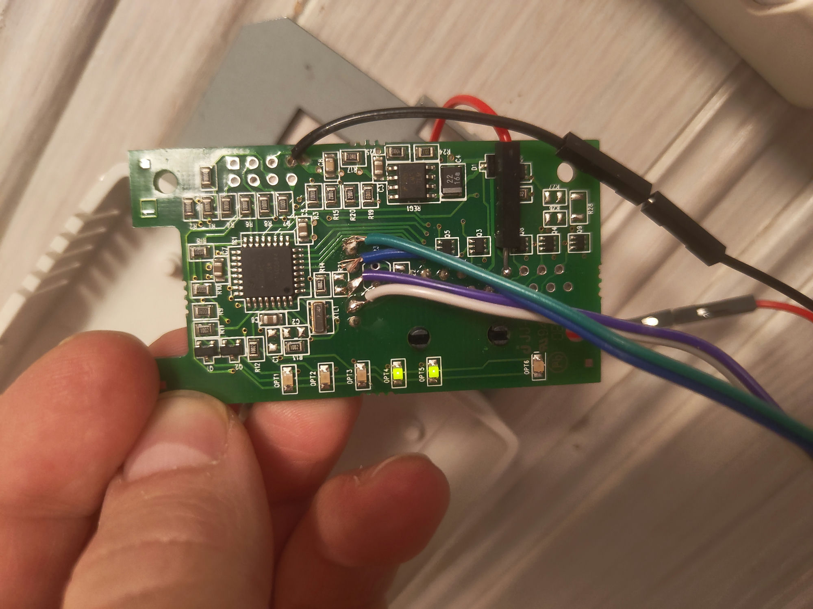
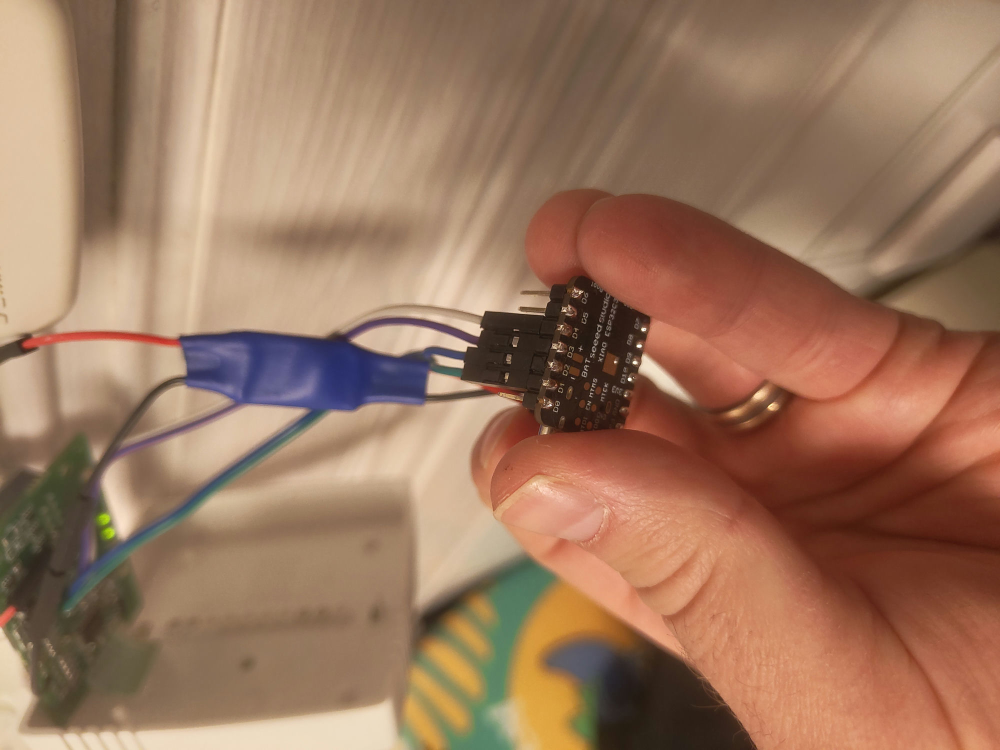
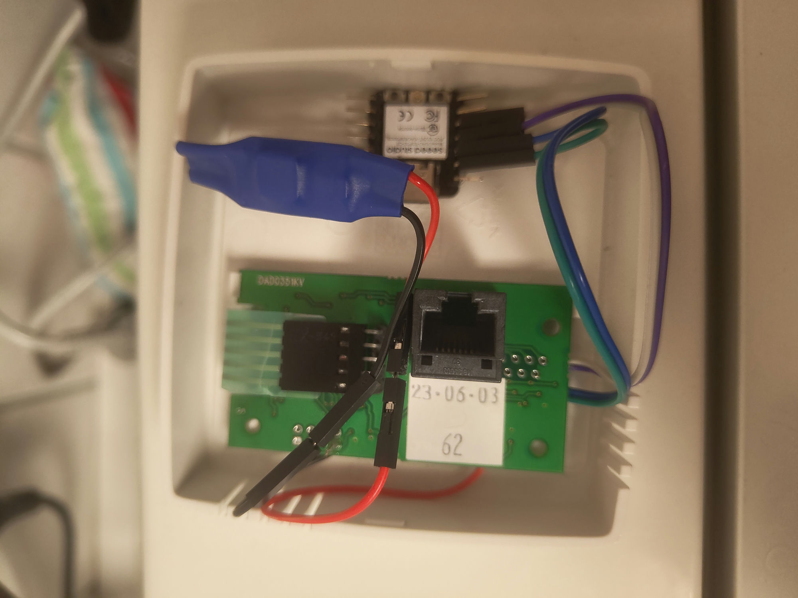
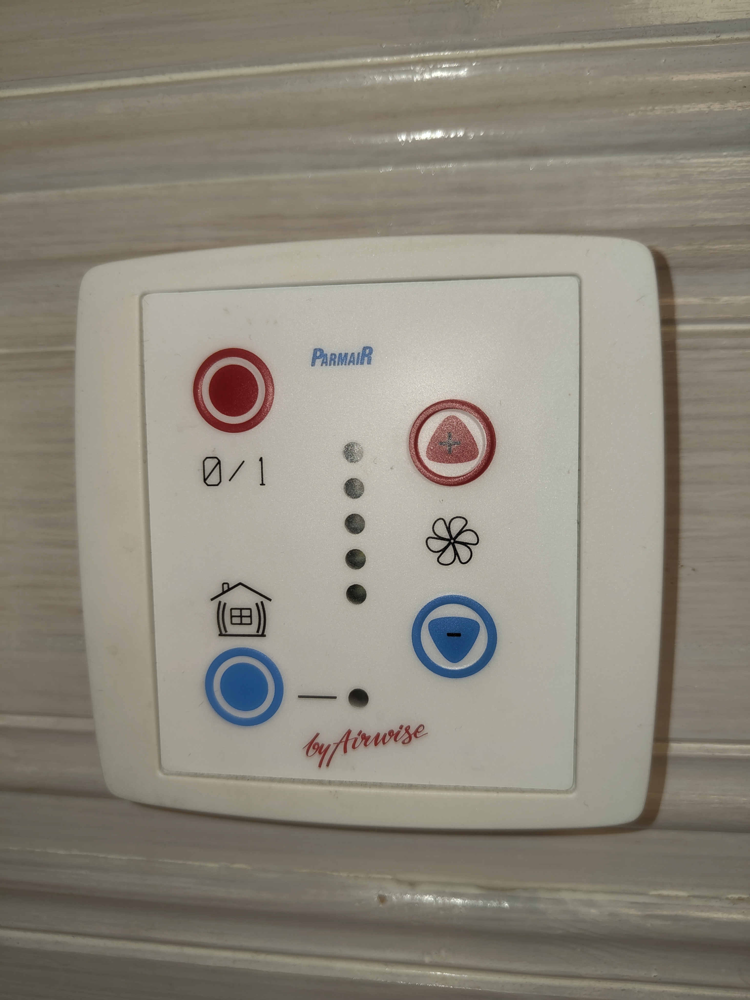

# Project photos

The remaining original photos document the controller and physical build.
Photos alone do not establish electrical compatibility or safe supply points.

Embedded camera/location metadata and auxiliary images have been removed
from the published photos. Original filenames are retained for documentation
links. Check metadata and visible labels again before adding new photos.

| Photo | Contents |
|---|---|
| [IMG_20261029_171347203.jpg](IMG_20261029_171347203.jpg) | Original wall controller, front view |
| [IMG_20261029_171415065.jpg](IMG_20261029_171415065.jpg) | PCB component side before modification |
| [IMG_20261029_171439435.jpg](IMG_20261029_171439435.jpg) | Ribbon and RJ connectors, opposite PCB side |
| [IMG_20261121_093746592.jpg](IMG_20261121_093746592.jpg) | Current build: added PCB wires and solder joints |
| [IMG_20261121_093800325.jpg](IMG_20261121_093800325.jpg) | Current build: XIAO ESP32-C3 wiring |
| [IMG_20261121_095113057.jpg](IMG_20261121_095113057.jpg) | Current build: XIAO and wiring inside the enclosure |

## Current build

These three photos were provided by the owner and show this project, not
the friend's separate Shelly Uni reference build.

Signal wires were added in parallel with the keypad PCB connection. Separate
wires also connect to other board points; their function, polarity, and load
capacity are not established from the photograph.

The XIAO connectors and a covered module are visible. The owner confirms the
supply module is a **12 V to 5 V buck converter**. Its exact model and ratings
are not documented. Wire colors are not a universal pinout; the module type
is owner-provided information, not an identification from its appearance.

This shows placement, not an approved protection arrangement. Separately check
solder-joint insulation, loose strands, mounting, strain relief, and whether
closing the lid stresses the wires. The photos do not verify supply-module
specifications or power-off back-power protection.

## Wall controller

## Photo maintenance

The earlier annotated pin-numbering, nameplate, and enclosure-width photos
have been removed. Their relevant observations are retained in the
[measurement notes](../docs/measurements.md). Do not reconstruct a viewing
direction or pin assignment from the remaining images without measurements.

Wire colors alone do not identify pins; captions and the [wiring guide](../docs/wiring.md)
describe function. A photo alone does not establish a power module's ratings or safety.
Duplicate keypad photos, unused earlier relay/buck alternatives, old 12 V measurement photos,
and the friend's Shelly reference images were removed during cleanup.
